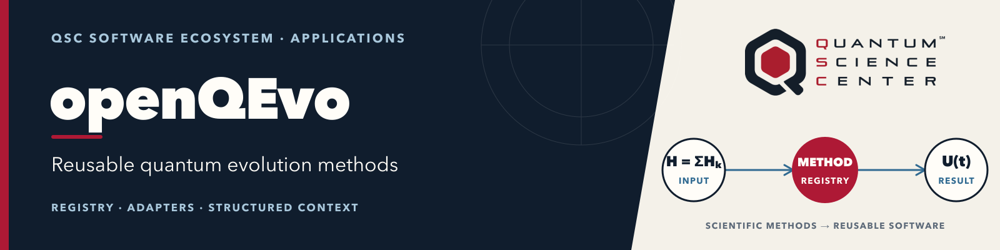
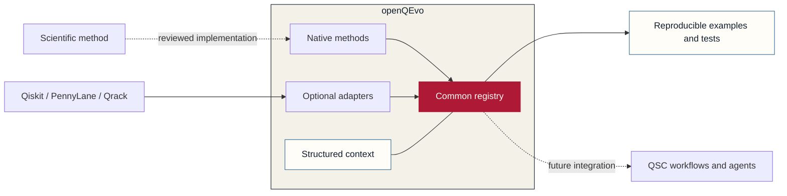
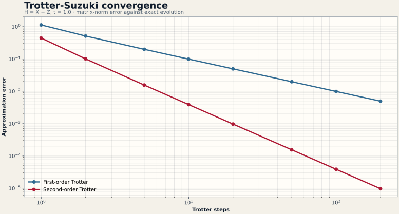

<p align="center">
  <a href="https://qscience.org/">
    
  </a>
</p>

# openQEvo

**openQEvo helps quantum-algorithm researchers turn evolution-method prototypes
into discoverable, tested, and reusable Python components through a common
method interface, registry, framework adapters, and structured context.**

[](https://github.com/QSCSoftwareThrust/OpenQEvo/actions/workflows/ci.yml)
[](pyproject.toml)
[](#project-status)

The current prototype covers exact evolution, first- and second-order product
formulas, a qDRIFT randomized baseline, and optional Qiskit, PennyLane, and
Qrack adapters. Interaction-picture, annealing, and other evolution families
remain research directions.

[See the example](#see-it-in-action) ·
[Quick start](#quick-start) ·
[Architecture](docs/architecture.md) ·
[Roadmap](docs/roadmap.md) ·
[Contributing](CONTRIBUTING.md)

> [!IMPORTANT]
> openQEvo is a source-installable, pre-alpha prototype—not a published
> release. The native product formulas are executable references with shared
> conformance evidence but still await Algorithms Thrust approval, and the project license is
> undecided.

## At a glance

| | |
| --- | --- |
| **QSC contribution** | Establishes a reusable engineering path from Algorithms Thrust research code to tested ecosystem software. |
| **Ecosystem area** | Applications |
| **Primary users** | Quantum-algorithm researchers, framework integrators, and QSC software teams |
| **Maturity** | Prototype (`Development Status :: 2 - Pre-Alpha`) |
| **Current milestone** | Obtain scientific approval for the executable references and complete the first licensed release. |
| **Lead / contact** | QSC Software Thrust via the [OpenQEvo issue tracker](https://github.com/QSCSoftwareThrust/OpenQEvo/issues) |
| **Last reviewed** | 2026-08-25 |

## Why this matters

Quantum-evolution research often begins as a standalone scientific script.
That is appropriate for exploration, but it makes methods harder to discover,
compare, validate, and reuse across frameworks. openQEvo provides a repeatable
route from those scripts to maintained software without hiding method
provenance or approximation limits.

For QSC, the project is also a concrete integration pattern: the Algorithms
Thrust supplies reviewed science, while Software Thrust teams contribute
packaging, tests, metadata, adapters, documentation, and future workflow
integration. The pattern can extend to other algorithm families after it is
validated here.

## What it does

- **Presents one method interface.** Native implementations and optional
  framework adapters implement the same `EvolutionMethod` contract.
- **Makes methods discoverable.** A registry supports `get()`,
  `list_methods()`, and `list_methods_detail()`.
- **Carries scientific context.** JSON records capture applicability,
  parameters, limitations, complexity, references, and example paths.
- **Checks convergence and consistency.** Tests compare approximation methods
  against exact small-system evolution and validate method metadata.
- **Provides scalable logical outputs.** Canonical Pauli inputs can return
  serializable operation sequences or circuits compiled to a fixed logical
  basis, with one-/two-qubit gate counts and depth.
- **Keeps integrations optional.** Qiskit, PennyLane, and Qrack adapters load
  only when their dependencies are installed.



*Figure 1. The registry and context layer provide a stable discovery boundary
while scientific implementations and external-framework adapters evolve.*

## See it in action

[](examples/trotter_convergence.py)

*Figure 2. The bundled `H = X + Z` example compares the reference first- and
second-order formulas against exact evolution. From 1 to 200 steps, the
second-order error falls from `4.44e-1` to `9.67e-6`; the first-order error
falls from `1.13e+0` to `4.94e-3`.*

Run the example in the terminal:

```bash
python examples/trotter_convergence.py
```

Recreate the figure after installing the optional visualization dependency:

```bash
python -m pip install -e ".[visualization]"
python examples/trotter_convergence.py \
  --plot .github/assets/trotter-convergence.svg
```

## Project status

Status below reflects the repository on 2026-09-01.

| Capability | Status | Evidence / boundary |
| --- | --- | --- |
| Exact matrix evolution | Available | Classical small-system reference with context metadata and tests |
| Canonical Hamiltonian contract | Available | Validated real-coefficient Pauli sums with explicit qubit ordering, serialization schema, hashes, and dense compatibility |
| Structured evolution result | Available | Versioned method, parameter, cost, seed, environment, warning, limitation, and output metadata |
| First-order Trotter | Approval pending | Dense, operation, and compiled reference-circuit outputs are implemented and tested; Algorithms Thrust review is still required |
| Second-order Trotter | Approval pending | Dense, operation, and compiled reference-circuit outputs are implemented and tested; Algorithms Thrust review is still required |
| qDRIFT randomized evolution | Approval pending | Reproducible dense, operation, and circuit trajectories plus expected-channel validation and ensemble statistics |
| Shared conformance | Implemented | Native, Qiskit, and PennyLane conventions are exercised on sign, coefficient, qubit-order, time, and term-order controls |
| Qiskit adapter | Implemented | Explicit product-formula synthesis, circuit output, compiled logical costs, and dependency-conditional tests |
| PennyLane adapter | Implemented | Explicit sign/order mapping, circuit output, compiled reference costs, and dependency-conditional tests |
| Qrack adapter | Experimental | Optional implementation with 7 fake-runtime integration tests; GPU/OpenCL validation remains pending |
| Structured context and recommendations | Available | Schema-validated method metadata, selection rules, and executable recommendation payloads |
| PyPI / Spack distribution | Planned | Source install works; no public package or Spack recipe is claimed |
| License and citation metadata | Blocked | License decision, `LICENSE`, and `CITATION.cff` are required before release |

## Quick start

### Install from source

```bash
git clone https://github.com/QSCSoftwareThrust/OpenQEvo.git
cd OpenQEvo
python -m pip install -e .
```

Install development tools or optional adapters as needed:

```bash
python -m pip install -e ".[dev]"
python -m pip install -e ".[qiskit]"
python -m pip install -e ".[pennylane]"
python -m pip install -e ".[qrack]"
python -m pip install -e ".[adapters]"
```

### Compare two evolution methods

```python
import openqevo

hamiltonian = openqevo.PauliHamiltonian(
    identifier="quickstart-xz",
    terms=(
        openqevo.PauliTerm(1.0, "X"),
        openqevo.PauliTerm(1.0, "Z"),
    ),
)

exact = openqevo.get("exact").run(hamiltonian, t=1.0)
approx = openqevo.get("trotter_s2").run(hamiltonian, t=1.0, steps=20)

print(openqevo.list_methods())
print("formula operations:", approx.costs.formula_level_pauli_operations)
print("unitary shape:", approx.unitary.shape)
```

The registry always lists the native/reference methods (`exact`, `trotter_s1`,
`trotter_s2`, and `qdrift`). Optional adapter names appear when their
dependencies are installed. Existing callers can continue passing dense matrix
terms to `evolve(...)`; see the [scientific contracts](docs/contracts.md) for
the canonical and structured APIs.

## Validation and evidence

- **Core and context:** tests cover registry behavior, Trotter and qDRIFT
  behavior, exact and commuting reference cases, expected convergence slopes,
  qDRIFT expected-channel convergence, recommendation execution, error
  handling, and JSON-schema validation.
- **Qiskit adapter:** 9 additional tests pass when Qiskit is installed.
- **PennyLane adapter:** 9 dependency-conditional tests cover the equivalent
  integration surface.
- **Shared conformance:** analytic cases normalize the target sign, Pauli
  rotation angle, logical/dense qubit order, coefficient handling, time, and
  serialized term order across native, Qiskit, and PennyLane implementations.
- **Qrack adapter:** 7 fake-runtime tests exercise decomposition and adapter
  behavior without requiring a host Qrack installation.
- **Continuous integration:** linting and the default test suite run on Python
  3.10, 3.11, and 3.12.
- **Reproducible example:** `examples/trotter_convergence.py` generates the
  tabular result and README figure from the same calculation.
- **Paper pilot:** `experiments/xz_pilot/` compares exact, first- and
  second-order Trotter, and 30 seeded qDRIFT trajectories under equal
  formula-level operation budgets. It archives raw JSONL records, an aggregated
  summary, an uncertainty-aware figure, and SHA-256 checksums.
- **Expanded study:** `experiments/publication_study/` freezes controlled
  Pauli, spin-model, and fixed mapped H₂ workloads; equal logical budgets; 30
  qDRIFT seeds; uncertainty rules; failure retention; compiled costs; and a
  write-once artifact manifest. Scientific approval remains pending.

Run the locally available suite with:

```bash
python -m pytest -q
ruff check .
ruff format --check .
```

The current CI environment installs the core development dependencies; optional
adapter tests skip when their framework is absent. A release gate is to exercise
supported adapters explicitly in CI.

## Current limitations

- Native Trotter and qDRIFT code has executable analytic and cross-framework
  evidence, but is not yet Algorithms Thrust-approved.
- Operation sequences and reference circuits are logical, all-to-all outputs;
  hardware routing and device-specific optimization remain backend work.
- qDRIFT's expected-channel bound does not guarantee the error of an individual
  trajectory; the frozen study reports trajectory variation separately.
- Qrack support is experimental; the included tests use a fake runtime, and
  GPU/OpenCL validation depends on the host environment.
- Krylov, interaction-picture, annealing, and automated method selection remain
  research or roadmap items. The expanded native study is still limited to
  small systems that permit exact dense references.
- The package is not on PyPI, no Spack recipe is claimed, and no stable API
  compatibility promise has been made.
- Licensing, citation, and approved QSC acknowledgment language remain open.

## Cross-project responsibilities

| Project | Contribution | Coordination |
| --- | --- | --- |
| **Algorithms Thrust** | Review and supply scientific method implementations | Current release gate |
| **HW — Hybrid Workflows** | Context, how-to guidance, and representative examples | [Issue #4](https://github.com/QSCSoftwareThrust/OpenQEvo/issues/4) |
| **DS — Data Schema** | Refine and validate method-context schema | [Issue #2](https://github.com/QSCSoftwareThrust/OpenQEvo/issues/2) |
| **AS — Agentic Software** | Define future MCP/RAG orchestration boundary | [Issue #3](https://github.com/QSCSoftwareThrust/OpenQEvo/issues/3) |
| **SE — Software Engineering** | Packaging, testing, CI, documentation, and release process | [Issue #1](https://github.com/QSCSoftwareThrust/OpenQEvo/issues/1) |

## Documentation

- [Architecture](docs/architecture.md) — method, registry, adapter, and context design
- [Scientific contracts](docs/contracts.md) — canonical Hamiltonians and structured results
- [Roadmap](docs/roadmap.md) — release gates and longer-term direction
- [Cross-project workflow](docs/cross-project.md) — collaboration model
- [Contributing](CONTRIBUTING.md) — development setup and review process

## Repository layout

```text
.
├── src/openqevo/   # Scientific contracts, registry, methods, and adapters
├── context/        # Input/result schemas and method metadata
├── examples/       # Reproducible demonstrations
├── tests/          # Core, context, and optional-adapter validation
└── docs/           # Architecture, roadmap, and cross-project workflow
```

## Roadmap

- **Now:** assign reviewers, approve the Trotter/qDRIFT definitions and frozen
  study, decide the license, and complete release metadata.
- **Next:** rerun the approved frozen protocol, publish explicit adapter CI,
  documentation, citation metadata, and the reproducibility bundle.
- **Later:** add reviewed methods such as Krylov and interaction-picture
  approaches, hardware-aware circuit compilation, validated Qrack acceleration,
  Spack support, and workflow or agent integrations.

See the [project roadmap](docs/roadmap.md) for the release gates and historical
planning context.

## Contributing

Contributions are welcome from QSC teams and the broader research community.
See [CONTRIBUTING.md](CONTRIBUTING.md) for method-integration requirements,
development setup, tests, style checks, and the review process.

## Citation and acknowledgment

A preferred citation and approved QSC funding acknowledgment have not yet been
published. Add `CITATION.cff` and the approved acknowledgment before the first
public release.

## License

The license is **not yet decided**. A `LICENSE` file and matching package
metadata are required before this repository is distributed as released
software.

## Contact

Use the [OpenQEvo issue tracker](https://github.com/QSCSoftwareThrust/OpenQEvo/issues)
for questions, method proposals, integration requests, or release blockers.
