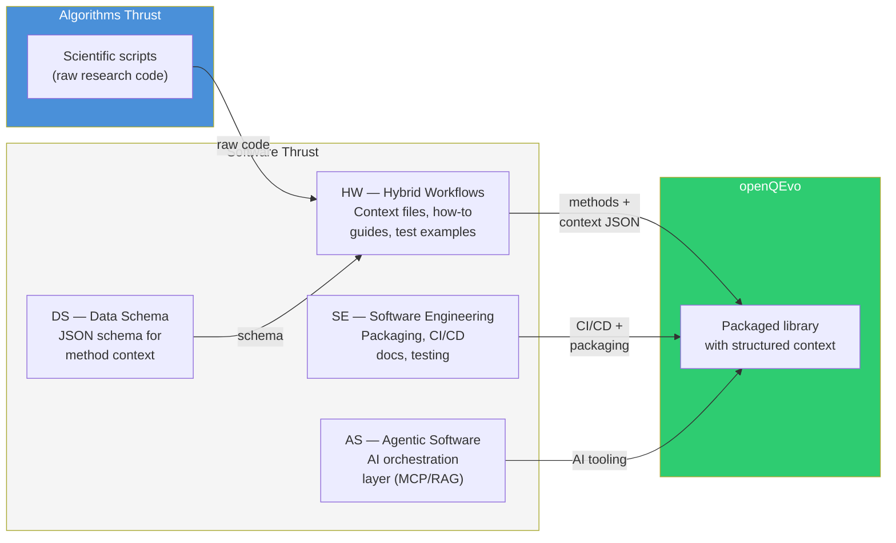
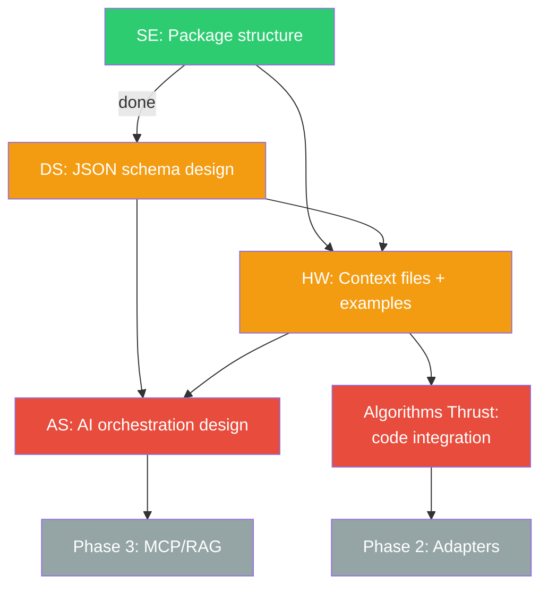

# Cross-project workflow

openQEvo is now maintained directly by the project owner, with the Agentic
Software (AS) team retaining its own method-selection and orchestration work.
The original cross-thrust map below is historical context, not an active
handoff model.

## Workflow

## Historical responsibilities

The HW, DS, and SE work items are closed. Their descriptions remain as a
record of the repository capabilities now maintained by the project owner.

### HW — Hybrid Workflows ([Issue #4](https://github.com/QSCSoftwareEcosystem/OpenQEvo/issues/4))

**What they deliver:**
- One JSON context file per evolution method (metadata, limitations,
  applicable Hamiltonians, complexity, references)
- How-to guides: when to use each strategy and on what types of Hamiltonians
- Test examples for each method
- Integration of the actual Algorithms Thrust code into `methods/`

**Key personnel:** Zack Windom (context and examples), Daniel Claudino (QC)

### DS — Data Schema ([Issue #2](https://github.com/QSCSoftwareEcosystem/OpenQEvo/issues/2))

**What they deliver:**
- JSON schema defining the structure of method context files
- Validation tooling for context files
- Alignment with the broader openQSE data schema

**Key personnel:** Thomas Naughton, Samuel Stein

**Related:** [DataSchema RFC #5 — trotterization schema requirements](https://github.com/QSCSoftwareEcosystem/DataSchema/issues/5)

### AS — Agentic Software ([Issue #3](https://github.com/QSCSoftwareEcosystem/OpenQEvo/issues/3))

**What they deliver:**
- Design for AI-assisted method selection using the structured context
- MCP or RAG integration so AI agents can discover and recommend methods
- Orchestration layer connecting openQEvo to hybrid workflows

**Key personnel:** Tirthankar Ghosal

**Dependency:** Needs the JSON schema (DS, issue #2) to be defined first.

### SE — Software Engineering ([Issue #1](https://github.com/QSCSoftwareEcosystem/OpenQEvo/issues/1))

**What they deliver:**
- Python package structure (`src/` layout, `pyproject.toml`) — done
- CI/CD workflows (GitHub Actions: lint, test, docs build)
- Documentation infrastructure (Sphinx or MkDocs)
- Branch protection rules and PR review setup
- Spack recipe for HPC deployment (Phase 3)

**Key personnel:** Seth Johnson

## Dependency chain

Legend: green = done, orange = in progress, red = blocked/waiting, gray = future

## Execution plan

### Delivery ownership

The project owner owns implementation, context curation, schema decisions,
validation, documentation, packaging, release coordination, and triage. AS
owns the remaining agentic work in [Issue #3](https://github.com/QSCSoftwareEcosystem/OpenQEvo/issues/3)
and [Issue #7](https://github.com/QSCSoftwareEcosystem/OpenQEvo/issues/7).
The closed HW, DS, and SE labels are historical only and create no delivery
dependency.

### Development branch policy

All current work remains on `dev`; no feature PR is required while the owner
iterates toward the agreed MPV milestone. Merge `dev` into `main` only after
the MPV scope and its validation evidence are complete.

### Current execution status — 2026-09-14

- The experimental dense Krylov, interaction-picture, and annealing methods,
  their context metadata, tests, example, and development Spack recipe are
  implemented and validated on `dev`.
- The obsolete non-executable interaction-picture recommendation has been
  removed. The hydrated selection rules now direct qualifying small-system
  cases to the executable dense interaction-picture reference and state its
  limits explicitly.
- The frozen publication-study inputs and result bundle are locally readable.
  Ruff checks, formatting checks, and the complete test suite pass (123 passed,
  2 skipped); the study verifier passes with 903 records, seven workloads, and
  zero retained failures. The bundle is reproducibility and validation evidence
  for the MPV; publication drafting is outside the MVP scope.

### Completed on 2026-09-10

- **[PR #8](https://github.com/QSCSoftwareEcosystem/OpenQEvo/pull/8) merged.**
  AS rebased the stale branch, corrected the embedded-Python formatting in
  `docs/architecture.md`, verified the full CI matrix, and merged the reviewed
  Krylov and qDRIFT research context. The context now supports the experimental
  dense Krylov implementation; it does not imply a scalable solver or
  hardware-ready Krylov method.

### Priority 0 — Close the AS contract decision

- **AS closes the recommendation-contract review in
  [Issue #7](https://github.com/QSCSoftwareEcosystem/OpenQEvo/issues/7).**
  Decide whether the recommendation schema needs user-query,
  Hamiltonian-feature, backend-constraint, ranking, or provenance fields, then
  record the OpenQEvo versus external-orchestrator boundary. The project owner
  will keep executable context examples aligned with that decision.

### Priority 1 — Review the completed MPV

1. **Complete (2026-09-14):** hydrate `context/selection/rules.json` and
   revise its stale interaction-picture executability rationale.
2. **Complete (2026-09-14):** validate the experimental dense Krylov,
   interaction-picture, and annealing references with the complete readable
   local test suite.
3. **Out of MVP scope:** publication drafting, authorship, affiliations, venue,
   acknowledgments, and submission review are deferred until a later project
   phase.
4. **Owner review remaining:** resolve the release formalities listed below
   before a public release.

AS may implement the MCP/RAG layer after its schema and ownership decisions
are recorded; it is not a prerequisite for the MPV milestone.

### Priority 2 — Defer release formalities until after MPV

The following are not current development blockers and will be scheduled after
the MPV scope is accepted:

- License, citation, PyPI, and branch-protection decisions.
- Qrack GPU/OpenCL validation and supported-adapter release gates.
- Upstream Spack publication. Spack is an HPC package manager; the local recipe
  is ready for development use, while upstream Spack needs a fixed release tag
  so installations can reproduce one exact source version on a cluster.

### Priority 3 — Expand methods deliberately

Hardware-aware routing, advanced interaction-picture and annealing schedules,
scalable Krylov solvers, and automated selection remain research or roadmap
work. The current Krylov, interaction-picture, and annealing methods are
experimental dense references. Promote a candidate only after it has reviewed
scientific source, implementation, tests, an example, and validated method
context.
