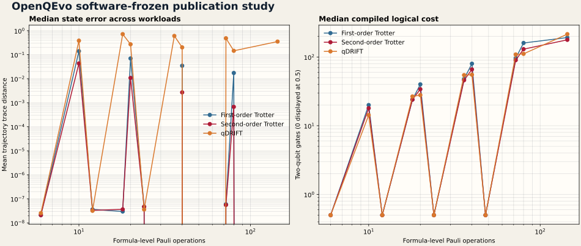

# Reproducible equal-budget benchmarking for Pauli-Hamiltonian evolution in OpenQEvo

**First review draft — 2026-09-14**

**Authors:** _To be confirmed by the project owner and contributors._  
**Affiliations:** _To be confirmed._  
**Target venue:** _To be selected._

## Abstract

Approximate Hamiltonian evolution is routinely evaluated with scripts whose
method settings, resource basis, random seeds, and raw outputs are difficult to
recover. OpenQEvo is a small-system scientific-software prototype that makes
these choices explicit through canonical Pauli-Hamiltonian contracts, a method
registry, structured results, and machine-readable context. We report a
software-frozen benchmark bundle comparing first-order Trotter, second-order
Trotter, and qDRIFT evolution at equal formula-level Pauli-evolution-operation
budgets. The bundle comprises 903 retained records over seven two- and
three-qubit workloads, including controlled Pauli families, transverse-field
Ising and Heisenberg models, and a fixed mapped two-qubit H2 operator. Exact
dense evolution supplies the reference. At the largest tested budget,
second-order Trotter has lower phase-aligned operator error than first-order
Trotter on every noncommuting workload in this bundle. The qDRIFT records show
substantial individual-trajectory variation, while their empirical ensemble
state error is smaller; several workload/budget pairs require more than the 30
archived trajectories to meet the protocol's target precision for the mean
trajectory error. These results are a reproducible software and benchmark
artifact, not a claim of hardware performance, asymptotic superiority, or
scientific approval.

## 1. Introduction

Hamiltonian simulation studies need more than an implementation of
`exp(-i H t)`. Reusable evidence requires an unambiguous Hamiltonian
representation, explicit sign and qubit-order conventions, reproducible random
choices, an honest resource comparison, and retained failed attempts. Without
those details, otherwise useful numerical comparisons are difficult to inspect
or extend.

OpenQEvo packages this evidence-oriented workflow for Pauli-Hamiltonian
evolution. Its native methods and optional framework adapters share canonical
input and result contracts. Method metadata records applicability,
parameters, limitations, complexity, references, and example paths. The
project is a pre-alpha prototype: its executable reference methods and this
study are intended to make assumptions reviewable, not to substitute for an
Algorithms Thrust review or a hardware benchmark.

This draft documents the first expanded, software-frozen OpenQEvo study. It
asks a deliberately narrow question: when first- and second-order product
formulas and qDRIFT are given the same formula-level Pauli-evolution operation
budget on small instances, what errors and trajectory variation are observed?
The answer is limited to the archived workloads, evolution time, and dense
reference used here.

## 2. Software and study design

### 2.1 Evolution methods

For a real-coefficient Pauli Hamiltonian \(H = \sum_j h_j P_j\), the target is
\(U(t) = \exp(-i H t)\). The deterministic comparators are the first-order
Lie--Trotter product formula and the symmetric second-order Suzuki product
formula. qDRIFT samples Pauli terms randomly according to coefficient-derived
probabilities and records every trajectory seed and sampled sequence.

OpenQEvo also contains experimental dense reference implementations of
Krylov, interaction-picture, and linear annealing evolution. They are not part
of this frozen comparison because they do not yet share a circuit or
formula-level operation model with the three benchmarked methods. In
particular, they must not be interpreted as scalable solvers or
hardware-ready implementations.

### 2.2 Frozen protocol and workloads

The protocol is versioned at
[`openqevo-publication-candidate-2026-09-01`](../experiments/publication_study/protocol.json).
It fixes evolution time \(t=0.75\), four logical-budget multipliers (1, 2, 4,
and 8), 30 qDRIFT seeds (260901--260930), 4,000 bootstrap resamples, a target
mean-confidence-interval half-width of 0.01, and a failure policy that retains
every failed run. The comparison basis is equal *formula-level
Pauli-evolution-operation budget*. It is not a comparison of routed physical
circuits, wall-clock time, or hardware fidelity.

The seven workloads are three-qubit controlled commuting, mixed, and dense
Pauli families; an additional dense high-\(\lambda\) controlled family; open
three-qubit transverse-field Ising and Heisenberg models; and a fixed mapped
two-qubit H2 operator. The H2 coefficients are archived from IBM Quantum
tutorial material as a fixed input. OpenQEvo does not claim to regenerate the
underlying electronic-structure transformation. Exact dense evolution is
available for every workload and is used solely as the numerical reference.

### 2.3 Measures and reproducibility

For each approximate unitary, the study reports phase-aligned operator error,
\(\|e^{i\phi}U-U_\mathrm{exact}\|_2 / \|U_\mathrm{exact}\|_2\), and trace distance
between the evolved computational-basis initial state and its exact result.
For qDRIFT, the study separately reports individual-trajectory statistics and
the trace distance of the empirical ensemble state. These are distinct
quantities: a small ensemble-state error does not establish a small error for
an individual stochastic trajectory.

The bundle archives the protocol, canonical workloads, resource estimate, raw
JSONL records, derived summary, overview figure, and SHA-256 manifest. The
included verifier rechecks byte counts and digests, then audits protocol,
workload, record, group, equal-budget, and qDRIFT-seed consistency. It
validates artifact integrity; it does not confer scientific approval.

## 3. Results

The archived run contains 903 records, 84 method/workload/budget summary
groups, 35,520 total formula-level Pauli-evolution operations, and zero
retained failures. Figure 1 summarizes median state error and compiled logical
cost against the formula-level budget. Compiled costs are supporting logical
estimates only; the study's matching criterion is the formula-level budget.



**Figure 1.** Overview generated from the frozen bundle. The left panel shows
median state error across workloads; the right panel shows median compiled
logical cost. The horizontal axis is formula-level Pauli-evolution operations.

Table 1 gives the largest-budget result for each workload. `S1` and `S2` are
single deterministic runs. qDRIFT operator and state columns are means over
30 individual trajectories; its ensemble column is the trace distance of the
empirical ensemble state. `n_0.01` estimates, using the protocol's normal
approximation, how many qDRIFT trajectories are needed to target a 0.01
confidence-interval half-width for the mean individual-trajectory state error.

| Workload | Budget | S1 operator error | S2 operator error | qDRIFT operator mean | qDRIFT state mean | qDRIFT ensemble state | `n_0.01` |
| --- | ---: | ---: | ---: | ---: | ---: | ---: | ---: |
| controlled commuting | 48 | 2.29e-15 | 1.49e-15 | 2.72e-1 | 0.00e+0 | 1.67e-15 | 1 |
| controlled mixed/skewed | 80 | 2.15e-2 | 7.65e-4 | 1.85e-1 | 1.43e-1 | 2.59e-2 | 94 |
| controlled dense/uniform | 80 | 2.04e-2 | 6.94e-4 | 1.88e-1 | 1.45e-1 | 2.86e-2 | 73 |
| controlled dense/high-\(\lambda\) | 80 | 6.03e-2 | 5.20e-3 | 3.44e-1 | 2.56e-1 | 7.72e-2 | 172 |
| transverse-field Ising | 80 | 4.67e-2 | 4.57e-3 | 4.18e-1 | 2.57e-1 | 8.64e-2 | 232 |
| Heisenberg | 144 | 8.10e-2 | 1.01e-2 | 6.14e-1 | 3.52e-1 | 1.48e-1 | 364 |
| fixed mapped H2 | 80 | 4.75e-3 | 1.30e-4 | 1.28e-1 | 4.14e-2 | 6.80e-3 | 26 |

**Table 1.** Largest archived formula-level budget for each workload. Values
are derived from
[`study_summary.json`](../experiments/publication_study/results-2026-09-01/study_summary.json).
The zero state-error entries for commuting, H2, and Heisenberg cases describe
the chosen initial state and numerical precision; they do not imply zero
operator error or broad state-independent accuracy.

For all six noncommuting workloads, the second-order product formula has lower
phase-aligned operator error than the first-order formula at the largest
archived budget. The controlled commuting case is, as expected, at numerical
precision for both product formulas. This is a finite-benchmark observation,
not an asymptotic comparison or a proof that second order is preferable under
all compilation and hardware constraints.

qDRIFT exhibits the expected separation between a stochastic trajectory and
its ensemble. At the largest budget, its mean trajectory state error ranges
from 0.0414 (fixed mapped H2) to 0.3517 (Heisenberg), whereas its empirical
ensemble-state error ranges from 0.00680 to 0.148. Except for the commuting
and H2 workloads, the estimated trajectory counts needed for the protocol's
0.01 precision target exceed the 30 archived trajectories. Consequently, the
qDRIFT means and bootstrap intervals in this bundle should be used as
exploratory estimates; increasing the trajectory count is required before
making precision-sensitive inferential claims for those cases.

## 4. Discussion and limitations

The main result is the artifact itself: a comparison can be rerun, inspected,
and challenged at the level of input coefficients, random sequences, raw
records, cost accounting, and derived plots. That is a practical foundation for
future cross-framework and hardware-aware studies. The experiment also
illustrates why a single state metric can be misleading. For the fixed initial
state, some methods have near-zero state trace distance despite a nonzero
operator error, so operator-level and state-level measurements should be read
together.

Several limitations bound the conclusions.

1. The study covers only two- and three-qubit dense-reference workloads at one
   evolution time. It does not establish large-system scaling.
2. Equal formula-level operations are a transparent common accounting basis,
   but they are not equal physical gate counts, routed depths, calibration
   error, or runtime on a quantum device.
3. The qDRIFT ensemble statistic and individual-trajectory statistic answer
   different questions. The frozen sample count is not sufficient for the
   protocol's stated precision target in five of seven largest-budget cases.
4. The fixed mapped H2 input is a chemistry-shaped benchmark input, not a new
   electronic-structure calculation.
5. Native Trotter and qDRIFT methods, the statistics protocol, and this draft
   await scientific review. Optional Qiskit, PennyLane, and Qrack adapters do
   not expand the evidence presented here.

The next technical study should pre-register a larger qDRIFT trajectory count
where indicated by the pilot sizing rule, broaden system sizes beyond dense
reference feasibility using an independently justified reference strategy, and
separate formula-level comparisons from hardware-native compilation and
execution experiments. Those additions should be versioned as a new bundle,
not silently mixed into this frozen one.

## 5. Data and software availability

All source artifacts used by this draft are in the repository:

- [Study protocol](../experiments/publication_study/protocol.json)
- [Study instructions and verifier](../experiments/publication_study/README.md)
- [Frozen result bundle](../experiments/publication_study/results-2026-09-01/)
- [Raw JSONL records](../experiments/publication_study/results-2026-09-01/study_records.jsonl)
- [Derived summary](../experiments/publication_study/results-2026-09-01/study_summary.json)
- [Integrity manifest](../experiments/publication_study/results-2026-09-01/manifest.json)

To verify the archived bundle without modifying it, run:

```bash
python -m openqevo.study \
  --verify-bundle experiments/publication_study/results-2026-09-01
```

The source package is currently a development project and is not yet a public
release. Licensing, citation metadata, archival DOI, and approved
acknowledgment language must be finalized before public submission or release.

## Acknowledgments

_Insert approved institutional, funding, and contributor acknowledgments before
submission._

## References

1. H. F. Trotter, “On the product of semi-groups of operators,” *Proceedings
   of the American Mathematical Society* **10**, 545–551 (1959).
2. M. Suzuki, “Generalized Trotter's formula and systematic approximants of
   exponential operators and inner derivations with applications to many-body
   problems,” *Communications in Mathematical Physics* **51**, 183–190 (1976).
3. E. Campbell, “Random compiler for fast Hamiltonian simulation,” *Physical
   Review Letters* **123**, 070503 (2019).
4. IBM Quantum Learning, “Variational algorithm design: examples and
   applications,” archived source for the fixed mapped H2 benchmark input,
   https://qiskit.qotlabs.org/learning/courses/variational-algorithm-design/examples-and-applications.
